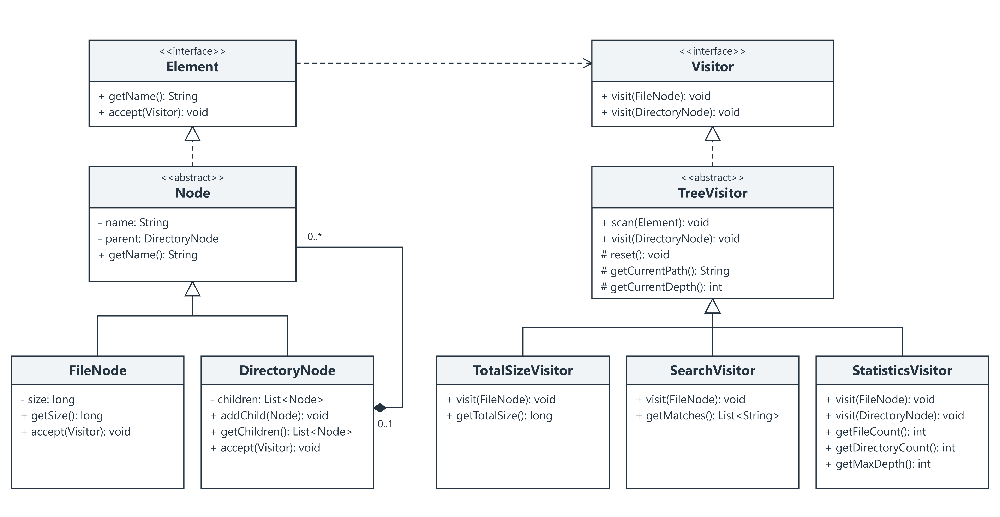

# File System with the Visitor Pattern

Assignment 6 | Software Design Patterns | Java 17 and Maven  
Student: **Kuatbay Merey** | Group: **SE-2537**  
Course: ShP-2216 | Academic year: 2026-2027

## 1 Introduction

The project models a small file system in memory. Files store a name and byte size; directories contain named children and can be nested. Three visitors work on the same tree: `TotalSizeVisitor` sums file sizes, `SearchVisitor` finds matching files, and `StatisticsVisitor` counts files and directories and finds maximum depth.

The application has ten small Java classes/interfaces. Maven builds Java 17 sources and runs JUnit 5 tests. The demonstration uses its own fixed data and requires no manual input or access to the real file system.

## 2 Design and traversal

`Element` declares `accept(Visitor)`. `Node` shares name validation and parent ownership. `FileNode` and `DirectoryNode` each implement their own one-line dispatch:

```java
public void accept(Visitor visitor) {
    visitor.visit(this);
}
```

There are two dispatch steps. First, calling `accept` through an `Element` reference selects the concrete element method. Inside `FileNode.accept`, `this` has type `FileNode`, so Java selects the `visit(FileNode)` overload; dynamic dispatch then calls the concrete visitor implementation. The directory follows the same process with `visit(DirectoryNode)`.

Visitors own traversal. `TreeVisitor.scan(root)` resets results, path and depth, then calls `root.accept(this)`. Its directory visit walks each child once. Elements never recurse. `StatisticsVisitor` counts a directory and calls the inherited directory visit once. This keeps traversal in one place and prevents files from being counted twice.

The current path starts empty. Descending to a child appends its name using `/`; the chosen directory root is omitted. Search uses a configurable `Predicate<String>` and `size >= minimumSize`, then stores matches in a `TreeSet` for lexical order. For a file root, the path is its filename. Depth starts at zero and increases for each edge, including edges to empty directories.

Names and sizes are immutable. `DirectoryNode.addChild` checks duplicates, existing ownership and ancestor/self cycles before mutation. Child lists and search results are immutable snapshots. Each visitor can be reused sequentially because `scan` resets its state; independent operations do not depend on their run order. Results are read after a successful scan. Recursion uses the JVM stack, and a total beyond the `long` range raises an overflow error.

## 3 Clean Code practices

**1. Meaningful naming.** `TotalSizeVisitor.getTotalSize()` and `SearchVisitor.minimumSize` state exactly what their values mean, so the caller does not need a numeric operation code or explanatory comment.

**2. Single Responsibility.** `FileNode` stores and validates file data, while `TotalSizeVisitor.visit(FileNode)` performs size accumulation; changing a calculation does not change element storage.

**3. Small methods.** Both element `accept` methods contain only `visitor.visit(this)`, making the dispatch step easy to locate and explain.

**4. Encapsulation.** `DirectoryNode.getChildren()` returns `List.copyOf(children)`, so callers cannot bypass `addChild` and break ownership, uniqueness or cycle checks.

**5. Eliminate type-checking chains.** `Visitor.visit(FileNode)` and `Visitor.visit(DirectoryNode)` select behavior through double dispatch, so the operations need no runtime type tests, reflection or casts.

## 4 Automated verification

The command `mvn test` passed on JDK 17.0.12 with Maven 3.9.12. The compiler also enables `-Xlint:all` and `-Werror`.

| Test class | Tests | Main checks |
| --- | ---: | --- |
| ElementTest | 12 | Both overloads, size/name validation, ownership, duplicates, cycles, read-only children |
| TotalSizeVisitorTest | 6 | Nested/subtree totals, file root, empty root, reuse, long values and overflow |
| SearchVisitorTest | 7 | Both filters, inclusive boundary, sorted/relative paths, empty/no match, snapshots and reuse |
| StatisticsVisitorTest | 5 | Counts, root depth, empty/file roots, repeated/interleaved scans and 64 nested levels |

Result: **30 tests, 0 failures, 0 errors, 0 skipped.** The test fixture is separate from the console example: it contains four files totaling 1720 bytes, four directories and maximum depth three. The search at a 300-byte threshold includes the exact boundary and excludes a large file with the wrong suffix. Invalid mutation tests also check that existing tree contents stay intact.

## 5 Demonstration and extension

Run from the repository root:

```text
mvn package
java -jar target/visitor-pattern-1.0.jar
```

The example tree contains seven files with sizes 120, 800, 240, 80, 400, 160 and 0 bytes. It includes `assets/drafts`, `docs` and an empty directory. Actual program output:

```text
Root: workspace
Total size: 1800 bytes
Search: suffix=.txt, minimum=200 bytes
assets/drafts/outline.txt
docs/guide.txt
Files: 7
Directories: 5
Maximum depth: 3
```

Passing `.md 100` after the JAR name changes the match to `docs/readme.md`; size and statistics remain the same. The two search constraints are case-sensitive suffix matching and an inclusive minimum size. The API also accepts other filename predicates, such as exact-name or prefix matching.

`StatisticsVisitor` was added after the first two visitors in the commit named "Extend operations with statistics without changing elements". That commit adds only the new visitor and its tests. `Element`, `Visitor`, `Node`, `FileNode`, `DirectoryNode` and `TreeVisitor` stay unchanged. The client then creates and runs the third visitor. New operations therefore extend the visitor hierarchy without editing existing elements.

Adding a new element type has the opposite trade-off: `Visitor` needs another overload, the new node needs its own `accept`, and each concrete visitor must handle the new type. Traversal also needs a rule if that type contains children. Visitor suits this project because the two element types are stable while independent operations can grow. The shared base class reduces repeated traversal code, at the cost of inheritance and the rule that a directory override must call `super.visit(directory)` once.

## 6 GitHub repository

[https://github.com/bossmerej-ship-it/SDP-6](https://github.com/bossmerej-ship-it/SDP-6)

The repository includes `pom.xml`, application sources, JUnit tests, README, both report formats and UML assets. Commits separate the model, verification, each visitor, console demonstration and documentation.

References: *Assignment 6 Visitor Pattern - Advanced File System*, supplied brief. [SDP-5](https://github.com/bossmerej-ship-it/SDP-5) was used as the reference for project and report style.

## Appendix UML class diagram



Figure 1. Dashed triangles show interface realization; solid triangles show inheritance. The filled diamond at `DirectoryNode` shows ownership of child nodes, with at most one parent per child. The dashed dependency from `Element` to `Visitor` represents the visitor argument. Public pattern methods and selected element fields are shown; constructors, private helpers and Java library types are omitted.
